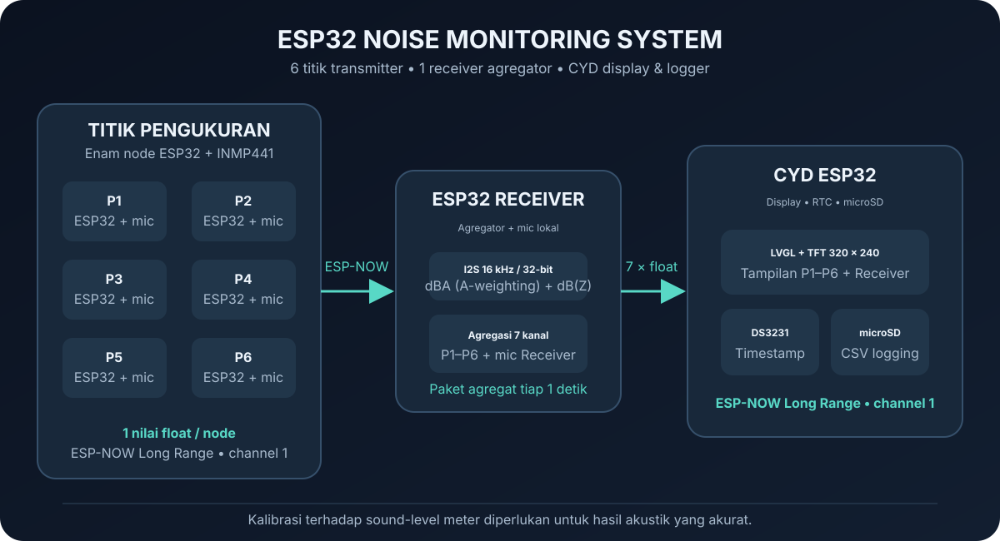
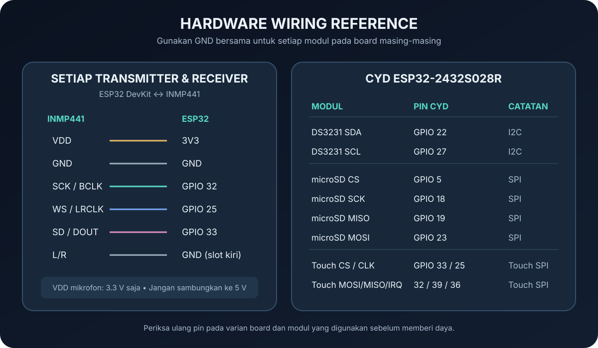

# ESP32 Noise Monitoring System

> **GitHub repository description:** ESP32-based noise monitoring with six INMP441 transmitter nodes, an ESP-NOW Long Range receiver, and a CYD display/logger with RTC and microSD.

Sistem ini mengukur tingkat kebisingan pada enam titik menggunakan ESP32 dan mikrofon digital INMP441. Enam transmitter mengirim bacaan melalui ESP-NOW ke satu receiver agregator. Receiver menambahkan pengukuran mic lokal, lalu mengirim tujuh kanal ke CYD untuk ditampilkan dan dicatat ke microSD dengan timestamp DS3231.



## Alur sistem

```text
6x ESP32 + INMP441  -- ESP-NOW Long Range, channel 1 -->  ESP32 Receiver
                                                           + INMP441 lokal
                                                                  |
                                     7 nilai float, tiap 1 detik   |
                                                                  v
                                                     CYD + DS3231 + microSD
```

- Setiap transmitter mengirim satu nilai `float` per paket.
- Receiver mengenali transmitter berdasarkan MAC, menandai data yang tidak diperbarui selama 5 detik sebagai tidak tersedia, lalu mengirim paket agregat tujuh `float` ke CYD.
- Receiver menghitung dBA dengan filter A-weighting dan dB(Z) dari mic lokal. Kanal ketujuh yang dikirim ke CYD adalah dBA lokal.
- CYD menangani tampilan LVGL, RTC, dan pencatatan microSD. Komunikasi ESP-NOW menggunakan Long Range pada channel 1.

## Isi repository

| Folder | Fungsi |
|---|---|
| `Transmitter_v2/` | Firmware untuk satu node transmitter. Gunakan firmware ini pada enam board; ubah ID label OLED jika diperlukan dan daftarkan MAC tiap board di Receiver. |
| `Receiver_v2/` | Menerima enam nilai, mengukur mic lokal pada I2S 16 kHz/32-bit, menghitung dBA/dB(Z), dan mengirim paket tujuh kanal ke CYD. |
| `ESPNOW_SoundMonitor_CYD/` | Firmware CYD untuk tampilan, penerimaan paket agregat, RTC DS3231, dan logging microSD. |
| `ESP32_RTC_DS3231_Test/` | Utilitas pengujian dan pengaturan waktu DS3231 melalui Serial Monitor. |
| `INMP441_MAC_Test/` | Utilitas diagnostik untuk menguji I2S INMP441 dan melihat MAC ESP32. Hasil levelnya dBFS, bukan SPL terkalibrasi. |
| `OLED_DTS013_Test/` | Utilitas pemeriksaan OLED I2C SH1106. |
| `docs/` | Diagram arsitektur serta skema koneksi modul. |

Tiga folder utilitas di atas adalah sketch pengujian terpisah, bukan bagian yang dijalankan bersamaan dengan firmware utama.

## Perangkat keras

### Setiap transmitter dan Receiver

Gunakan ESP32 dan satu INMP441 per board. Sambungan mikrofon yang digunakan firmware:

| INMP441 | ESP32 |
|---|---|
| VDD | 3V3 |
| GND | GND |
| SCK / BCLK | GPIO 32 |
| WS / LRCLK | GPIO 25 |
| SD / DOUT | GPIO 33 |
| L/R | GND (slot kiri) |

Receiver memakai konfigurasi I2S 16 kHz/32-bit. Transmitter_v2 memakai 44.1 kHz/32-bit untuk pengukuran. Pastikan sambungan I2S pada masing-masing board benar.

### CYD

| Modul | Pin CYD |
|---|---|
| DS3231 SDA / SCL | GPIO 22 / GPIO 27 |
| microSD CS / SCK / MISO / MOSI | GPIO 5 / 18 / 19 / 23 |
| Touch IRQ / MOSI / MISO / CLK / CS | GPIO 36 / 32 / 39 / 25 / 33 |



## Konfigurasi sebelum upload

1. Pastikan setiap node memakai ESP-NOW **Long Range** dan **channel 1**. Sketch Transmitter_v2, Receiver_v2, dan CYD dalam repository ini sudah mengatur konfigurasi tersebut.
2. Upload firmware CYD dan buka Serial Monitor untuk mencatat MAC CYD. Isi `CYD_MAC` di `Receiver_v2/src/main.cpp` dengan alamat perangkat yang benar.
3. Isi `SENDER_MACS` pada `Receiver_v2/src/main.cpp` dengan MAC STA keenam transmitter yang dipakai. Pastikan urutannya sesuai nomor P1 sampai P6.
4. Upload Receiver dan catat MAC STA yang dicetak saat startup. Masukkan MAC itu pada slot Receiver (`SOURCE_MACS` nomor 7) di `ESPNOW_SoundMonitor_CYD/src/main.cpp`.
5. Untuk keenam transmitter, gunakan project `Transmitter_v2`. Ubah `TRANSMITTER_ID` jika ingin label OLED setiap perangkat berbeda. ID hanya label; Receiver mengidentifikasi tiap board berdasarkan MAC.
6. Sesuaikan `RECEIVER_MAC` pada `Transmitter_v2/src/main.cpp` dengan MAC STA Receiver.
7. Upload firmware ke setiap board, lalu nyalakan Receiver dan CYD. Pastikan semua perangkat berada dalam jangkauan radio dan menggunakan mode/channel yang sama.

**MAC pada repository ini sengaja dikosongkan sebagai placeholder.** Masukkan MAC aktual pada perangkat sebelum digunakan, tetapi jangan unggah alamat perangkat pribadi ke repository publik jika tidak ingin membagikannya.

## Build dan upload

Setiap folder firmware adalah project PlatformIO tersendiri. Buka folder yang sesuai di VS Code/PlatformIO atau jalankan:

```sh
pio run -d Transmitter_v2
pio run -d Receiver_v2
pio run -d ESPNOW_SoundMonitor_CYD
```

Upload ke board dengan target PlatformIO `upload` pada project masing-masing. Pastikan port serial yang dipilih sesuai board.

Firmware CYD menggunakan partisi aplikasi besar agar UI muat pada flash. Partisi ini tidak menyediakan OTA; pembaruan firmware CYD dilakukan melalui USB. Ini tidak menonaktifkan ESP-NOW.

## RTC dan logging

CYD membaca waktu kalender dari DS3231 dan menyimpan data ke microSD. Jika RTC kehilangan daya, firmware CYD dapat mengisinya dari waktu kompilasi; verifikasi waktu dan zona waktu setelah startup. Sketch `ESP32_RTC_DS3231_Test` juga menyediakan perintah `SET YYYY-MM-DD HH:MM:SS` dan `GET` melalui Serial Monitor.

## Catatan pengukuran

Pembacaan INMP441 membutuhkan kalibrasi terhadap sound-level meter sebelum digunakan sebagai pengukuran akustik yang akurat. Firmware transmitter mengirim hasil level dB berdasarkan RMS dan koefisien kalibrasi yang tersedia di sketch; pembobotan A dan dB(Z) dihitung secara lokal oleh Receiver. Sistem ini bukan instrumen yang otomatis terkalibrasi atau tersertifikasi.

## Lisensi

Pilih dan tambahkan lisensi repository sebelum distribusi publik. Periksa juga lisensi library pihak ketiga yang diambil PlatformIO.
